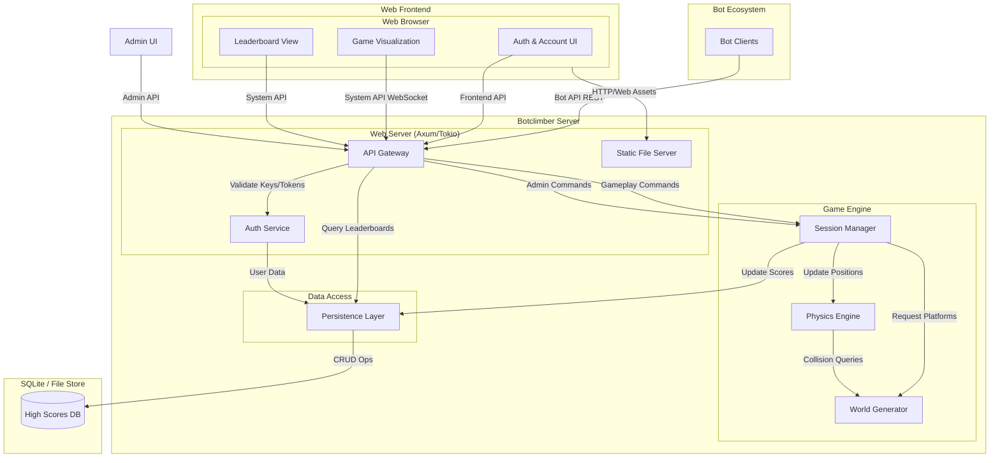

# Botclimber: Component Diagram

This document describes the high-level architecture of the Botclimber application using a component-based approach.

## Component Overview

The following diagram illustrates the primary components and their interactions.

## Component Descriptions

### 1. Botclimber Server
The core backend system, encompassing the web interface, game simulation, and data management.

*   **Web Server (Axum/Tokio)**:
    *   **API Gateway**: The entry point for all REST requests. It routes requests to the appropriate internal services (Bot API, Frontend API, Admin API, System API).
    *   **Auth Service**: Handles player registration, login, and API key verification.
    *   **Static File Server**: Serves the static web assets (HTML/JS/CSS) for the single-page application (SPA).
*   **Game Engine**:
    *   **Session Manager**: Tracks all active player figures, their current sessions, and game modes. It coordinates the "Join" and "Leave" logic, and updates player scores in the persistence layer.
    *   **Physics Engine**: The core simulation loop (60Hz). It applies gravity, processes jump velocities, and handles collision reflections (AABB vs AABB) based on the **Game Rules**.
    *   **World Generator**: Manages the platform data for the tower. For the prototype, it implements a **fixed repeating pattern**. It provides platform data to the Physics Engine for collision detection and to the API for state reporting.
*   **Data Access**:
    *   **Persistence Layer**: Abstracts the underlying storage (SQLite). It manages all-time high scores and user account credentials.

### 2. Bot Ecosystem
*   **Bot Clients**: User-developed programs that interact with the Bot API to play the game.

### 3. Web Frontend
*   **Web Browser**: A Svelte/TypeScript single-page application that runs in the user's browser:
    *   **Auth & Account UI**: Interface for registration, login, profile updates, and API key generation.
    *   **Game Visualization**: Real-time rendering of the tower, platforms, and players based on the System API.
    *   **Leaderboard View**: Displays global high scores and active session rankings.
