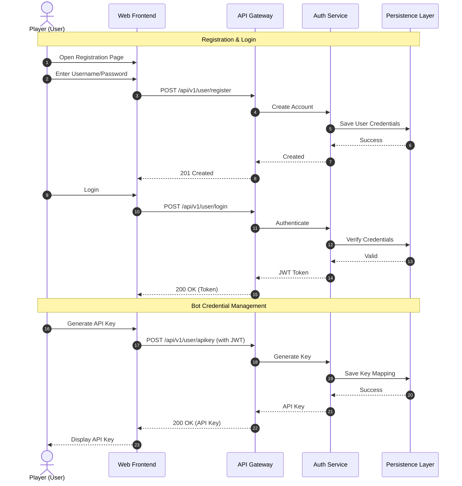
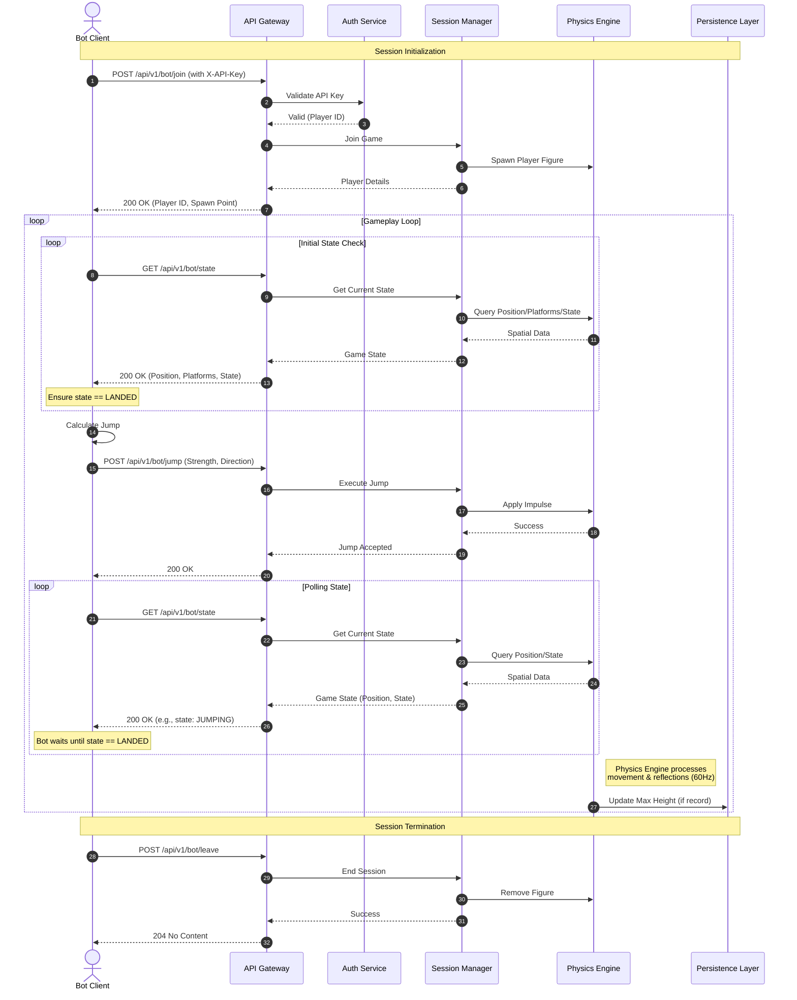

# Botclimber: User Interaction Sequence Diagrams

This document illustrates the two distinct interaction cycles within the Botclimber system: **Account Management** (performed by a human via the Web Frontend) and **Bot Gameplay** (automated via the Bot API).

## 1. Account Management Cycle (Human)

This phase occurs through the Web Frontend and involves creating an account, authenticating, and managing bot credentials.

## 2. Bot Gameplay Cycle (Automated)

This phase is performed by the user's Bot Client using the unique API Key generated in Phase 1. It is technically independent of the Web Frontend.

## Phase Descriptions

### 1. Account Management
This cycle is typically performed by a human user through the **Web Frontend**.
*   **Registration & Login**: The user creates an account and authenticates to receive a JWT token.
*   **API Key Generation**: The user retrieves a unique API key, which is the secret used by their bot for all gameplay interactions.

### 2. Bot Gameplay
This cycle is performed by the user's **Bot Client** using the Bot API.
*   **Joining**: The bot enters the game world. The server associates the API key with a unique player session.
*   **The Loop**:
    *   **State Retrieval**: The bot polls the spatial state to understand its surroundings (platforms and position).
    *   **Decision Making**: The bot calculates the optimal jump based on the **Game Rules**.
    *   **Jump Command**: The bot sends the jump vector to the server.
*   **Physics Simulation**: The server's Physics Engine handles the actual movement, gravity, and reflections asynchronously at 60Hz.
*   **Graceful Exit**: The bot informs the server when it is finished to free up resources.
